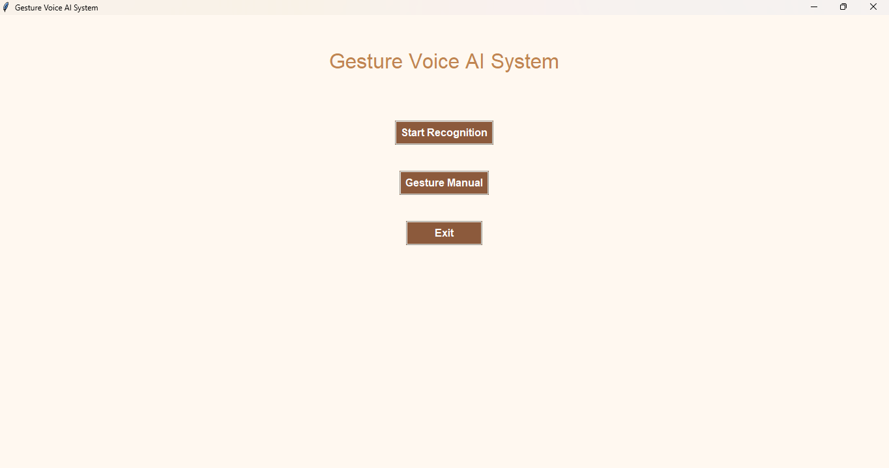
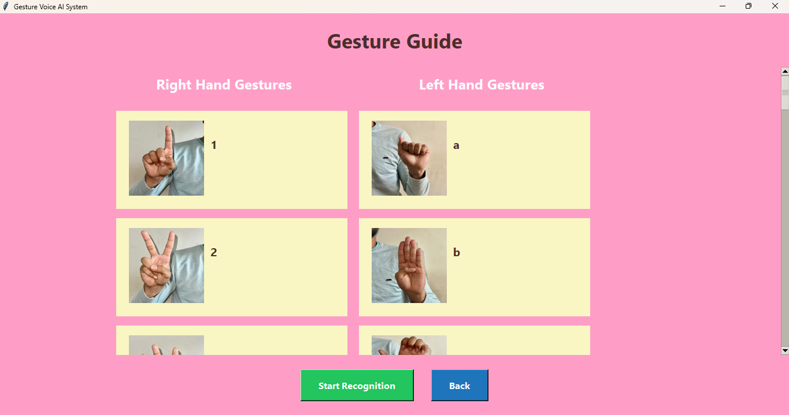
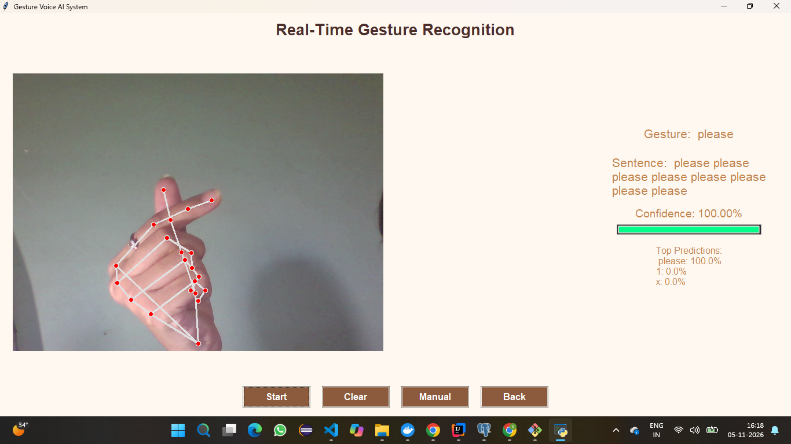

# GestureVoiceAI

Real-time hand gesture recognition that converts gestures into speech. The webcam captures your hand, MediaPipe extracts hand landmarks, a TensorFlow model classifies the gesture, and the recognized words are built into a sentence and spoken aloud.

**Tech stack:** Python, OpenCV, MediaPipe, TensorFlow/Keras, pyttsx3 (text to speech), desktop GUI.

## Demo





<!-- After uploading the demo video, replace the link below and remove these comment markers:
[Watch the demo video](PASTE-VIDEO-LINK-HERE)
-->

## Features

- Real-time hand tracking and gesture recognition from a webcam
- Separate gesture sets for the right hand (digits and common words) and the left hand (letters)
- Recognized gestures are combined into a sentence
- Spoken output using text to speech
- Confidence score and top predictions shown for each gesture
- Built-in Gesture Guide screen showing every supported gesture
- Buttons to start, clear the sentence, open the manual, and go back

## Supported gestures

| Hand  | Gestures                                      |
|-------|-----------------------------------------------|
| Right | `0` to `9`, `hello`, `yes`, `no`, `please`, `thankyou`, `i` |
| Left  | letters `a` to `z`                            |

Reference images for every gesture are in `gesture_images/`, and they are also shown inside the app under **Gesture Manual**.

## How it works

1. The webcam captures a frame.
2. MediaPipe detects the hand and returns 21 landmark points.
3. The landmarks are passed to a trained TensorFlow model, which predicts the gesture and a confidence score.
4. The predicted gesture is added to the sentence.
5. The sentence is converted to speech.

## Project structure

```
GestureVoiceAI/
├── collect_dataset.py     # Collect gesture samples into gesture_dataset.csv
├── gesture_dataset.csv    # Collected landmark dataset
├── train_model.py         # Train the model from the dataset
├── gesture_detector.py    # Hand detection and gesture prediction
├── realtime_system.py     # Real-time recognition loop
├── speech_engine.py       # Text to speech
├── gui.py                 # Application entry point (desktop GUI)
├── gesture_images/        # Reference images for each gesture
├── models/                # Trained model and label encoder
├── docs/screenshots/      # Screenshots used in this README
└── requirements.txt       # Python dependencies
```

## Requirements

- Windows 10/11 (the steps below use Command Prompt)
- Python 3.10, 3.11 or 3.12 (TensorFlow and MediaPipe do not support newer versions such as 3.13)
- A working webcam
- Speakers or headphones for the voice output

Check your Python version:

```
python --version
```

## Installation

1. Clone the repository and open the project folder:

   ```
   git clone https://github.com/Vaishnavi-Desale31/GestureVoiceAI.git
   cd GestureVoiceAI
   ```

   The code is on the `github-clean` branch. If you do not see the project files, switch to it:

   ```
   git checkout github-clean
   ```

2. Create a virtual environment:

   ```
   python -m venv venv
   ```

3. Activate it:

   ```
   venv\Scripts\activate
   ```

   Your prompt should now start with `(venv)`.

4. Install the dependencies:

   ```
   pip install -r requirements.txt
   ```

## Run the application

With the virtual environment active, start the app:

```
python gui.py
```

Then:

1. Click **Start Recognition** on the home screen.
2. Click **Start** to turn on the webcam.
3. Show a gesture to the camera. Keep your hand inside the frame, in good light.
4. The gesture, the sentence and the confidence appear on the right, and the sentence is spoken.
5. Use **Clear** to reset the sentence, **Manual** to see all gestures, and **Back** to return home.

A pre-trained model is already included in `models/`, so you can run the app without training anything.

## Collect data and retrain (optional)

Only needed if you want to add gestures or improve accuracy.

1. Collect gesture samples with the webcam:

   ```
   python collect_dataset.py
   ```

   Follow the prompts shown in the terminal or window.

2. Train a new model from the collected data:

   ```
   python train_model.py
   ```

   The trained model and label encoder are saved in `models/`.

3. Run the app again with `python gui.py` to use the new model.

## Troubleshooting

- **Camera does not open:** close other apps that use the webcam (Zoom, Teams, Meet) and check Windows Settings > Privacy > Camera.
- **`pip install` fails or TensorFlow will not import:** check that you are on Python 3.10 to 3.12, and use a fresh virtual environment.
- **No voice output:** check your volume and default audio device. Text to speech uses the voices installed in Windows.
- **Gestures are detected poorly:** use bright, even light, a plain background, and keep the whole hand visible.
- **`'venv\Scripts\activate' is not recognized`:** make sure you are in the project folder and that you created the environment with `python -m venv venv`.

## Known limitations and future improvements

- The same gesture can be added to the sentence repeatedly while it is held. A hold-time or cooldown check would add each gesture only once.
- The vocabulary is limited to the supported gestures above.
- It is a desktop application. A web version (browser camera with a Flask or FastAPI backend) would let it be deployed online.

## My contribution

Write here, in your own words, which part of the project you worked on (for example data collection, model training, the GUI, or speech output).

## Author

Vaishnavi Desale
GitHub: [Vaishnavi-Desale31](https://github.com/Vaishnavi-Desale31)